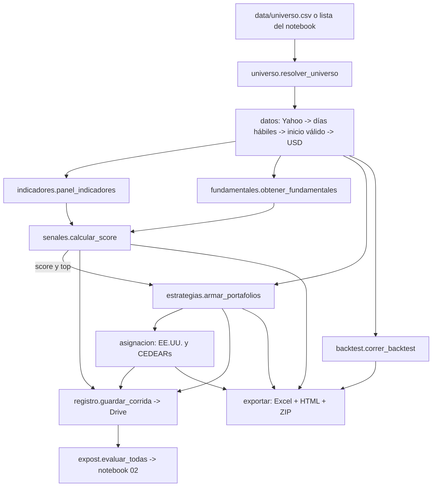

# Arquitectura

## 1. Principios

- **El código vive en `src/`; los notebooks solo configuran y muestran.** Cada notebook clona el repo en Colab
  (celda SETUP), así que un cambio en `src/` llega a Colab apenas se pushea.
- **Los `.ipynb` se generan** con `scripts/gen_notebooks.py` (no se editan a mano; `tests/test_notebooks.py`
  verifica que coincidan y que se versionen sin salidas).
- **Una sola lógica para hoy y para el backtest**: `estrategias.armar_portafolios` arma los 8 portafolios con
  los datos hasta una fecha; la usan `Analisis.optimizar` y `backtest.correr_backtest`.
- **Sin dependencias pesadas**: optimizadores propios con scipy; plotly, scikit-learn (Ledoit-Wolf) y yfinance.
  Todo lo que usa Colab ya está instalado allá (salvo la última `yfinance`, que la celda SETUP actualiza).
- **Tests sin red** (datos sintéticos en `tests/conftest.py`) que corren en GitHub Actions con Python 3.12.

## 2. Módulos

| Módulo | Responsabilidad | Usa |
|---|---|---|
| `config.py` | `Config` (dataclass con todos los parámetros), perfiles `HORIZONTES`, `UMBRALES_SENALES` | — |
| `universo.py` | lee `data/universo.csv`, resuelve la lista del usuario (alias, monedas por sufijo, CEDEAR por defecto) | config |
| `datos.py` | descarga de Yahoo, días hábiles, inicio válido, conversión a USD, calidad, `^IRX`, cotizaciones de CEDEARs (data912) | universo |
| `fundamentales.py` | `Ticker.info` en paralelo → tabla de valuación y P/E relativo al ETF del sector | datos |
| `indicadores.py` | paneles de indicadores, foto a una fecha, media vida y Hurst | — |
| `senales.py` | percentiles, score por grupo, señales absolutas, alertas, clasificación, top de oportunidades | — |
| `metricas.py` | CAGR, volatilidad, Sharpe, Sortino, máxima caída, Calmar, VaR/CVaR, beta/alfa; tabla por activo | — |
| `riesgo.py` | retornos, ventana, gemelos, Ledoit-Wolf, retornos esperados, aversión al riesgo, Black-Litterman | — |
| `portafolios.py` | optimizadores, `limpiar_pesos`, frontera, contribuciones al riesgo, resumen | — |
| `estrategias.py` | `armar_portafolios`: ventana → gemelos → covarianza/μ → 8 portafolios | riesgo, portafolios |
| `asignacion.py` | cantidades enteras (greedy), precios de CEDEARs, asignación mixta, equivalentes | — |
| `backtest.py` | rebalanceos, walk-forward con costos, IC del score | indicadores, senales, estrategias, metricas |
| `registro.py` | carpeta por defecto (Drive/local), guardar/listar/cargar corridas | — |
| `expost.py` | precios para las corridas, evaluación por corrida, ranking, exportación del seguimiento | datos, metricas |
| `graficos.py` | figuras plotly (paleta validada, un color fijo por portafolio) | indicadores, portafolios, senales |
| `tablas.py` | tablas con formato (pandas Styler) para los notebooks y el reporte HTML | — |
| `exportar.py` | Excel (openpyxl), reporte HTML autocontenido, ZIP, descarga en Colab | registro |
| `pipeline.py` | clase `Analisis` que orquesta todo y arma metadata, Excel, figuras y ZIP | todos |

## 3. Flujo

Pasos de `Analisis` (cada uno se puede repetir tras cambiar `A.cfg`, sin volver a bajar datos):
`cargar_datos` → `calcular_senales` → `optimizar` → `asignar` → `correr_backtest` → `guardar` → `exportar`
(o `correr_todo`).

## 4. Formato del registro

Una carpeta por corrida, `AAAAMMDD_HHMMSS` (hora de Argentina; si ya existe, se agrega `_2`), en
`Mi unidad/oportunidades_inversion/registros/` (Colab) o `registros_local/` (PC):

| Archivo | Contenido |
|---|---|
| `metadata.json` | `run_id`, `fecha_hora`, `fecha_datos`, `version_codigo`, `version_repo`, `benchmark`, `tasa_libre_riesgo`, `fuente_tasa`, `config` (todos los parámetros), `tickers_pedidos`, `activos_analizados`, `referencias`, `sin_datos`, `excluidos_del_universo`, `excluidos_optimizacion` {activo: motivo}, `gemelos`, `ventana_optimizacion` [inicio, fin, días], `monedas`, `portafolios`, `top_oportunidades`, `mep_implicito`, `resumen_ic_backtest`, `avisos` |
| `senales.csv` | una fila por activo: nombre, tipo, rubro, todos los indicadores, fundamentales, scores por grupo, `score`, `n_senales`, `senales`, `alertas`, `clasificacion`, `ranking` |
| `pesos.csv` | formato largo: `portafolio` (clave de `portafolios.NOMBRES`), `activo`, `peso` (solo > 0) |
| `resumen_portafolios.csv` | por portafolio: `clave`, retorno esperado, volatilidad, Sharpe, n° de activos, peso máximo, n efectivo, top 3, métricas `_hist` |
| `asignacion.csv` | `activo`, `peso_objetivo`, `precio`, `cantidad`, `monto`, `peso_real`, `nota`, `vehiculo`, `alternativas`/`fuente_precio`, `portafolio`, `opcion` (EE.UU./CEDEARs), `sobrante` |
| `precios.csv` | precio en USD de cada activo en la fecha de los datos |

`registro.cargar_corrida` devuelve un dict con esas piezas; `expost` solo necesita `metadata.fecha_datos`,
`pesos` y `senales` (score y clasificación), así que versiones futuras pueden agregar archivos sin romper el
seguimiento de corridas viejas.

## 5. Cómo extender

- **Otra métrica de señal**: calcularla como panel en `indicadores.panel_indicadores` (solo ventanas hacia
  atrás), agregarla a `senales.METRICAS` con grupo y orientación, opcionalmente un umbral en
  `config.UMBRALES_SENALES` y la regla en `senales._reglas`, una etiqueta en `graficos.ETIQUETA_METRICA` y una
  columna en `tablas.COLUMNAS_SENALES`. Documentarla en `docs/METODOLOGIA.md` §2-3 y agregar un test.
- **Otro portafolio**: función en `portafolios.py`, clave y nombre en `portafolios.NOMBRES` (el orden define el
  color en `graficos.COLOR_PORTAFOLIO`: máximo 8 colores categóricos — un noveno exige quitar otro o cambiar la
  paleta), cálculo en `estrategias.armar_portafolios` (entra solo en el backtest y en el registro), test en
  `tests/test_portafolios.py`.
- **Otro ticker por defecto**: una fila en `data/universo.csv` (columnas en el docstring de `universo.py`);
  `tests/test_universo_datos.py` controla la cantidad de filas y estados.
- **Cambiar un notebook**: editar `scripts/gen_notebooks.py`, correr `python scripts/gen_notebooks.py`, probar con
  nbconvert en `_local_run/` y correr los tests.
